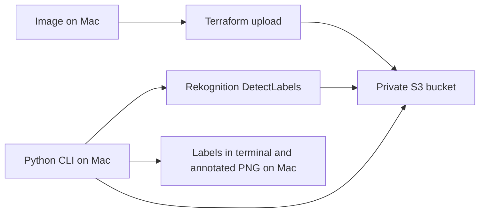

# AWS Image Labels Generator

An AWS and Python portfolio project that identifies objects and concepts in photos. Terraform creates an Amazon S3 bucket and uploads an image; a Python command-line program calls Amazon Rekognition `DetectLabels`, prints the returned labels and confidence scores, and saves a locally annotated image with bounding boxes for detected object instances.

**Status:** The infrastructure deployed successfully in `us-east-2`, and the program produced results for two different images. This is a local command-line workflow, not a hosted website.

## Architecture



Terraform manages the bucket, public-access block, and any S3 objects declared in the configuration. The Python program calls Rekognition using the bucket name and object key; it also downloads the image from S3 to draw the returned boxes. The annotated PNG is saved on the Mac, not uploaded to S3.

## AWS services and tools

| Component | Role |
| --- | --- |
| Amazon S3 | Stores the source image under an object key such as `images/city-image.png`. |
| Amazon Rekognition | Returns general labels, confidence scores, and bounding boxes for object instances when available. |
| AWS IAM | Authorizes the identity used for provisioning and the identity running the Python program. |
| Terraform | Defines the AWS resources and returns the created bucket name and image key. |
| Python, Boto3, Pillow, Matplotlib | Calls AWS APIs, reads the source image, and saves the annotated result. |

## Repository layout

```text
.
├── main.tf                 # Terraform resources and outputs
├── label-generator.py      # Local Rekognition CLI and image annotation
├── wild-animals.jpeg       # Sample input, if licensed for redistribution
├── city-image.png          # Second input, if licensed for redistribution
├── README.md
└── screenshots/            # Add your own proof images before publishing
```

Your Terraform configuration may currently manage just one sample image. To keep both inputs in S3 at once, define two separate `aws_s3_object` resources with distinct keys. Changing the `key` on one resource replaces the object that Terraform manages; it does not retain the old image automatically.

## Prerequisites

- Terraform, Python 3, and the AWS CLI installed on your Mac.
- An AWS profile or other local credentials configured for the intended account. Do not commit credentials or Terraform state.
- Permissions to create the Terraform resources, upload and read S3 objects, and call `rekognition:DetectLabels`.
- JPEG or PNG images in the project directory that you have the right to use.

Create a Python virtual environment:

```bash
python3 -m venv .venv
source .venv/bin/activate
python -m pip install boto3 pillow matplotlib
```

For a reproducible repository, record the installed dependencies in a `requirements.txt` file and install from it on subsequent machines.

## Deploy

From the directory containing `main.tf`:

```bash
aws sts get-caller-identity
terraform init
terraform fmt -check
terraform validate
terraform plan
terraform apply
terraform output
```

Review the account and the Terraform plan before applying. In the demonstrated deployment, Terraform reported `4 added, 0 changed, 0 destroyed` and returned:

```text
bucket_name = "labels-generator-081b9655"
image_key   = "images/wild-animals.jpeg"
```

The bucket suffix is generated, so use the outputs from **your** deployment instead of copying that example name. The S3 bucket and the Rekognition request must use the same Region; this project uses `us-east-2`.

## Run label detection

The script accepts the bucket, exact S3 object key, Region, and optional output filename:

```bash
python label-generator.py \
  "$(terraform output -raw bucket_name)" \
  "$(terraform output -raw image_key)" \
  --region us-east-2 \
  --output animals-labeled.png
```

When analyzing another object already uploaded to the same bucket, pass its key explicitly and choose a different output file:

```bash
python label-generator.py \
  "$(terraform output -raw bucket_name)" \
  images/city-image.png \
  --region us-east-2 \
  --output city-labeled.png
```

The default output name is `labeled-image.png`. Running the program twice without `--output` writes both results to that same path, so use unique names to preserve each annotated image. The second command requires `images/city-image.png` to exist in S3 first.

## Observed results

### Wildlife image

An initial run against `images/wild-animals.jpeg` completed successfully and saved an annotated PNG. The terminal reported:

```text
Animal: 96.3%
Antelope: 96.3%
Wildlife: 96.3%
Outdoors: 95.9%
Zebra: 94.8%
Herd: 93.8%
Nature: 93.3%
Giraffe: 91.4%
Elephant: 90.8%
Grassland: 80.5%

Labels detected: 10
Annotated image saved to: labeled-image.png
```

### City image

A subsequent run against `images/city-image.png` also completed successfully:

```text
Road: 100.0%
City: 100.0%
Metropolis: 100.0%
Urban: 100.0%
Person: 99.5%
Tarmac: 99.5%
Adult: 99.3%
Male: 99.3%
Man: 99.3%
Car: 99.1%

Labels detected: 10
Annotated image saved to: city-labeled.png
```

The percentages above are Rekognition's reported confidence scores for labels. A scene label can have no bounding box; a label can also have multiple object instances. These results do not establish an exact count of animals, people, or cars.

> Portfolio images: after copying your actual files into `screenshots/`, add links here, for example ``. Include the wildlife image only after preserving or regenerating its annotated PNG. Screenshot paths here are examples until those files are added to the repository.

## Problems solved

| Problem | Diagnosis and resolution |
| --- | --- |
| Terraform reported that locked AWS provider `5.99.1` did not meet `~> 6.0` and that `hashicorp/random` was missing. | The configuration and dependency lock file disagreed. The recommended correction was to use `~> 5.0` for the existing AWS provider and rerun `terraform init` to install the new random provider. Verify the exact provider selection in your own lock file before describing it as a completed upgrade. |
| Python initially pointed to a different bucket than Terraform. | Use the `bucket_name` Terraform output when calling the script rather than keeping a second hard-coded bucket name. |
| After the Terraform-managed object was changed to `images/city-image.png`, a later wildlife request raised `InvalidS3ObjectException`. | The wildlife key was no longer present in S3. The city request succeeded. Keep each sample as its own Terraform resource, or reupload the wildlife file before requesting it again. |
| The two runs initially used the same local output filename. | Supply distinct `--output` values so the second annotated image does not overwrite the first. |

The two successful runs show that the application works with different subjects. The later failed wildlife request illustrates why an S3 object key must match an object that currently exists, even when an earlier request using that key succeeded.

## Portfolio evidence

Before publishing, add the actual annotated PNGs and screenshots you want to share. A concise set is: Terraform's apply summary and outputs, a terminal result for each image, and both annotated images. If the wildlife PNG was overwritten, upload the wildlife object again and regenerate `animals-labeled.png` before claiming that both annotated examples are included. Check image reuse rights and crop any account identifiers or sensitive information from screenshots.

## Cleanup

When finished collecting evidence, run `terraform destroy` in the same directory and inspect its plan. Terraform deletes the objects it manages. Remove any *other* objects you uploaded to the bucket before destroying it if S3 reports that the bucket is not empty. Keep local copies of the annotated PNGs and screenshots you need for the portfolio.

## Possible extension

A future version could accept uploaded images through a web interface and return labels without running a local command. That would require additional hosting and API infrastructure; the current project demonstrates the S3 and Rekognition workflow through a Python CLI.
